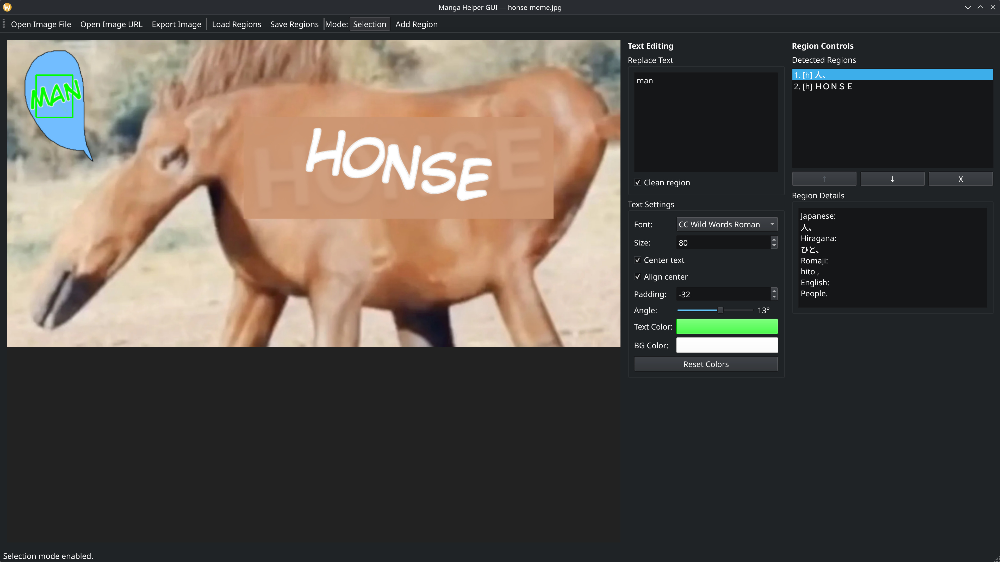
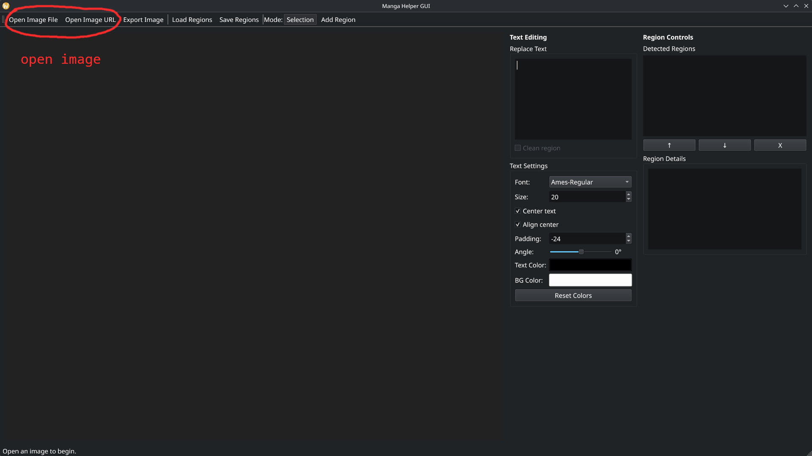
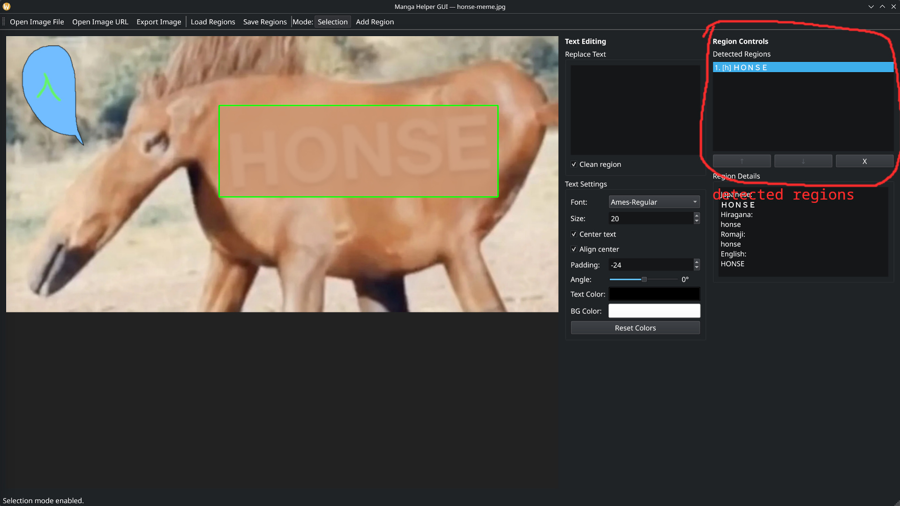
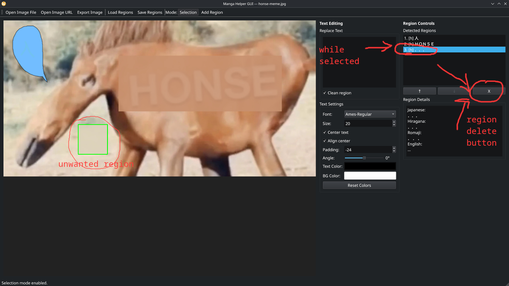
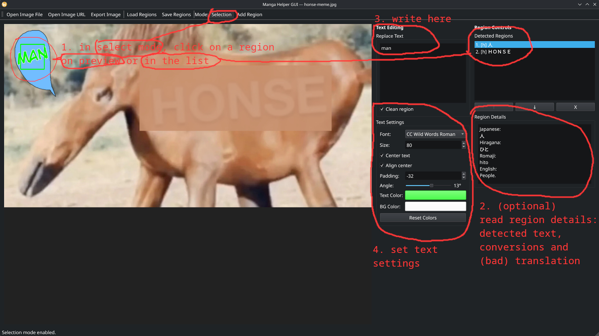
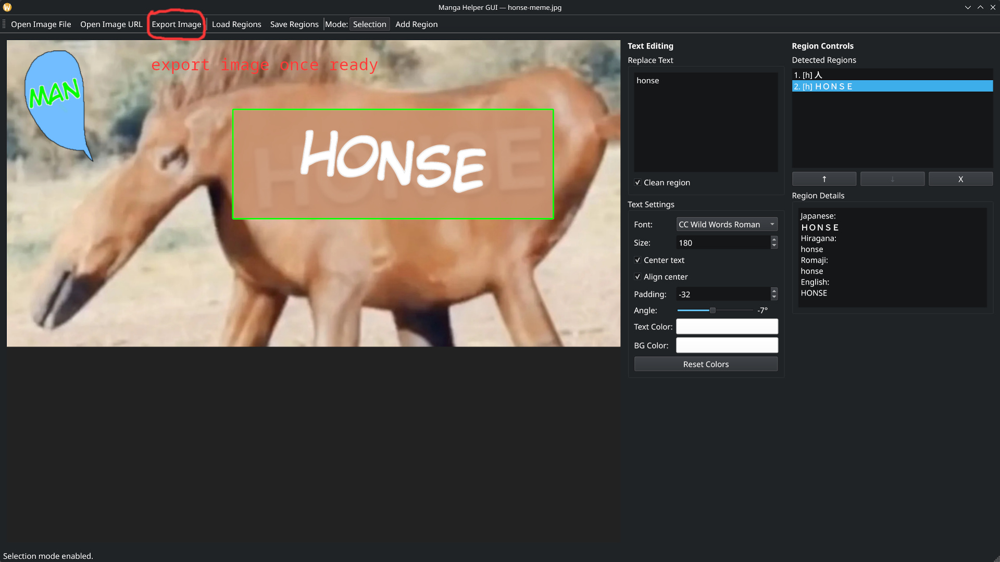
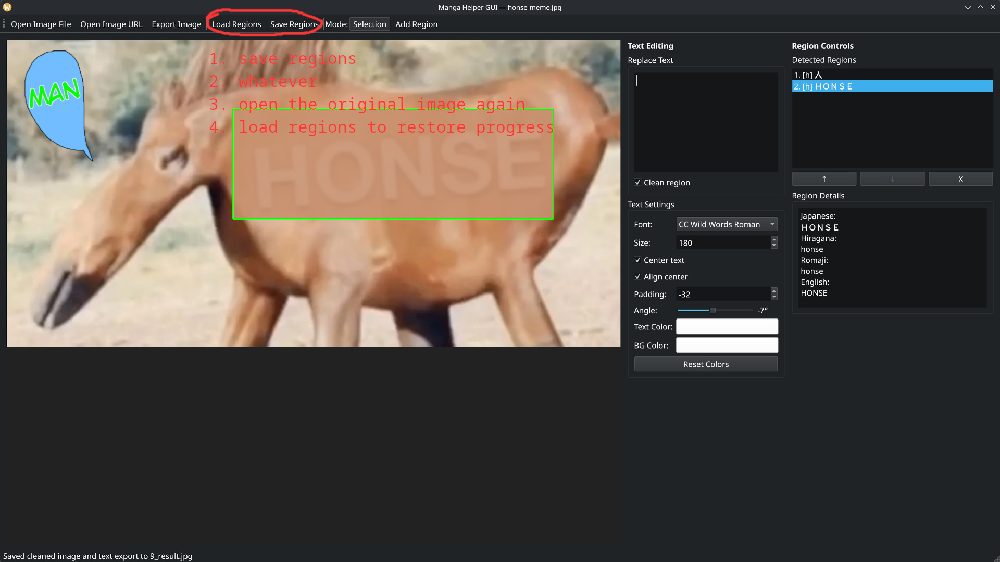

# Manga Helper

A GUI-first tool for learning and assisting with manga translation. It cleans the opened image, allows for text editing, extracts Japanese text from manga images and provides multiple representations to help readers who understand spoken Japanese but need help with kanji.



All used ML models are cached and used strictly locally. No information leaves your device when using them.

## Features

- **Text Detection**: Finds all text regions in manga images using EasyOCR
- **OCR Extraction**: Recognizes Japanese text (both vertical and horizontal) using MangaOCR
- **Learning Aids**: 
  - Shows original kanji text
  - Converts kanji to hiragana (phonetic representation) for pronunciation help
  - Romanizes text to romaji (Latin characters) for reference
  - Provides English translation for context
- **Image Cleanup**: Removes text from images by:
  - Sampling the background color from each text region
  - Replacing text with the appropriate background color
  - Using semi-transparent overlays (80% opacity) for natural blending
- **Manga Reading Order**: Sorts detected text regions in proper manga reading order (top-to-bottom, right-to-left)

## Requirements

- Python 3.10+
- recommended uv packager manager
- ~1 GiB RAM/VRAM and disk space for OCR models (downloaded on first run), 200 MiB more if using the redraw feature
- optional GPU acceleration (uses CPU in not available)

If you don't know how to install Python or uv, watch a YT tutorial.

## Installation

Using `uv` package manager:

```bash
uv sync --extra redraw
```

Or without the redraw feature:

```bash
uv sync
```

Or with standard pip:

```bash
pip install -e .
```

## Usage - GUI (recommended)

Run the graphical interface from the project root:

```bash
uv run gui.py
```

### Load in the image - either local file or from URL
The first time you do this will take a while - models will be downloaded and loaded in memory.



### Now you see all the detected text regions in the `Detected Regions` list on the right.
You can select a text area from the list, or by clicking on the preview.



### Correct the detected text regions if you see anything wrong.
- Resize them by dragging the edge

- Create any regions the automatic detection missed by selecting `Mode: Add region` on the top menu (Leave it by selecting `Mode: Selection`). In this mode you can add a new region by clickling and dragging your mouse to select a rectangle - the region you want to select.

- Delete redundant text regions by selecting a region to delete and pressing the `X` button below the list.


### You're all set up - let the fun begin
Select the first region. You might've already noticed that `Region Details` on the right shows some interesting information - different representations of the text and a translation. You can copy-paste the translation if it looks good, treat it as a suggestion or ignore it.

> If you know some spoken Japanese but not the Kanji you will still get value out of reading the Hiragana or Romaji. You can also copy a Kanji you don't know and learn what it means in context.

Look at the `Text Editing` sidebar. With a selected region, you can write your text in the `Text Replacement` box, and choose font, size etc. from the options below. Steps to add more fonts is described in [Fonts](README.md#fonts) section of this readme.



Repeat for the rest of the regions.

### Export the final image
Press on the `Export Image` button in top menu, and select where do you want to save it.



#### The beautiful result


### Need to pause?
Use the `Save Regions` button (and type file name where to save them) to save regions data. You can close the app, and when you're ready to resume - open the image again, press `Load Regions` and select the file you saved them to.

> Note: loading regions will replace current regions, potentially losing data. A prompt will appear asking if you're sure.



## Usage - CLI

```bash
uv run main.py <image_path>
```


The CLI produces:

1. **Console output** with detected text for each region:
  ```
  === Detected Japanese Text (in reading order) ===
   
  1. [horizontal]
    Japanese: こんにちは
    Hiragana: こんにちは
    Romaji:   konnichiha
    English:  Hello
  ```

2. **Output image** (`output.jpg`) with text areas cleaned and blended with the background

## Project Structure

- **[main.py](main.py)** - CLI entry point and workflow orchestration
- **[ocr.py](ocr.py)** - Text detection and OCR extraction
- **[text_processor.py](text_processor.py)** - Japanese text conversion and translation
- **[image_cleaner.py](image_cleaner.py)** - Image manipulation and text area cleanup
- **[inpainting.py](inpainting.py)** - Text area redrawing
- **[gui.py](gui.py)** - GUI launcher (PySide6)

## Technical Details

Only local models.

### Text Detection

Uses EasyOCR with Japanese language support.

### Text Extraction

MangaOCR is used for actual character recognition because it:
- Handles both horizontal and vertical Japanese text
- Is specialized for manga with various fonts and styles
- Supports vertical text without manual rotation

#### Why use two different OCRs?

Because one is good at region detection, the other at extracting text. EasyOCR breaks when text is vertical, MangaOCR is trained for this and generally better here.

## Considered features
- show text editing column only when a region is selected
- center the image in preview
- load dir of images and navigate through them with different side-bar
- move mode
- translate with context - doesn't seem to work with this model

None of them are my priority, so if you want something then write to me and ask nicely - then I'll think about it.

## Use Cases

- **Translation**: Best case scenario it's enough to just copy-paste from one box to another. Usually it's not that easy and human judgement is necessary.
- **Learning kanji**: See hiragana and romaji alongside kanji to understand pronunciation
- **Reading comprehension**: Get English translations for unfamiliar words while reading
- **Text extraction**: Extract raw Japanese text from manga for studying (can use CLI)
- **Clean scans**: Remove text from manga panels for re-translation (can use CLI)

## Fonts

The GUI includes built-in support for fonts from your system and from the `./fonts/` directory. Fonts suitable for manga/comic text styling are automatically discovered from system paths. Any fonts you add to the `./fonts/` directory will be available in the font selector without filtering.

### Included Font Licenses

The default font - CC Wild Words Roman, included in the `./fonts/` directory - is licensed under the **SIL Open Font License (OFL)**, which permits free personal and commercial use. See `fonts/OFL.txt` for full license details.

## License

MIT
